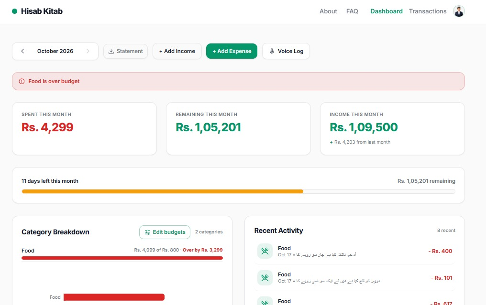
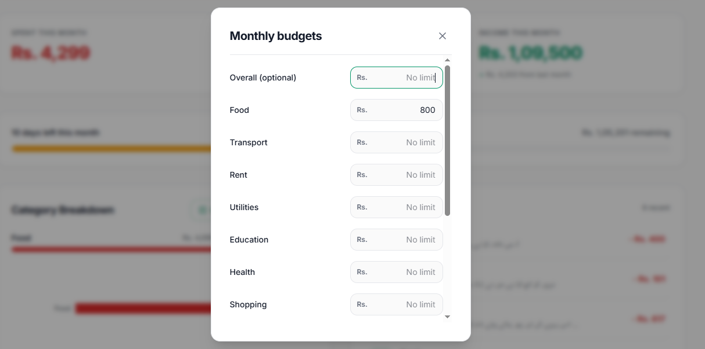
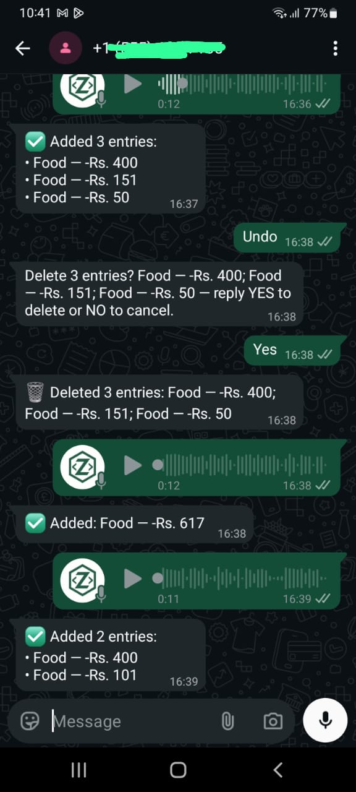
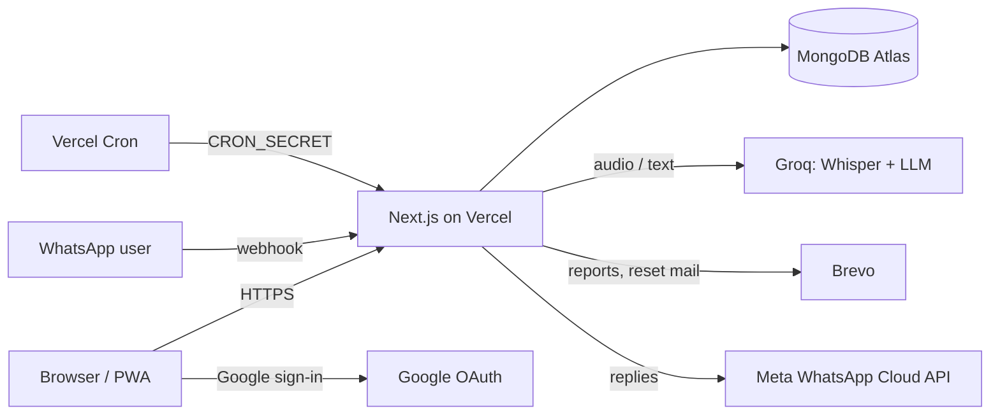

# Hisab Kitab

**A simple monthly money tracker for everyday life in Pakistan.** Log income and spending by typing or by voice, see what's left this month, set category budgets, and get weekly and monthly email summaries.

**Live:** https://hissab-kitab-eosin.vercel.app/ &nbsp;·&nbsp; Built by [Zalvro](https://zalvrohq.com)

   

<!-- TODO: add a hero screenshot -->


---

## Why this exists

Most expense apps ask you to fill long forms, so people stop using them. Hisab Kitab is built around one idea: logging an expense should take about five seconds. Say *"aj shawarma 500 ka"* and it is saved, categorised and counted.

## Features

**Logging**
- **Voice logging.** Speak in Urdu, Roman Urdu, English, or a mix. Audio is transcribed with Whisper and parsed by an LLM into structured entries. Audio is never stored.
- **Multiple entries in one sentence.** *"chai 50, rickshaw 200, salary 50000 mili"* becomes three entries (up to 5 per message). Income vs. expense is detected from phrasing (`mila/aya` vs `kharch/diya`).
- **Quick Add** forms for income and expenses, with edit and delete.

**Understanding your month**
- **Dashboard:** month switcher, Spent / Remaining / Income cards with carry-forward from earlier months, a Month Runway bar, category chart, and recent activity.
- **Budgets:** per-category limits plus an optional overall cap. Warnings at 80% and 100%. A budget can apply "this month and onward" or "only this month", and past months keep the budget that applied then.
- **Live sync:** the dashboard picks up changes made elsewhere within about 20 seconds, without a full-page refresh.
- **Transactions page:** income and expenses together, grouped by week, with a date filter.
- **Statement:** download a monthly PDF. Export everything as CSV.

**Reports**
- **Weekly email** (Mon–Sun) and **monthly email** with a short AI-written summary and tips, sent through Brevo. Weekly emails include a budget check when a limit is near or over.

**Account**
- Email + password and Google sign-in. Forgot password / first-time password set (works for Google accounts too), profile photo, password change, and full account deletion.
- Onboarding wizard for new users.

**Mobile**
- **Installable PWA** (Android Chrome, iPhone Safari via Add to Home Screen). Offline shows a generic offline page only. Financial data is never cached offline, by design.

**WhatsApp (experimental)**
- Log expenses by text or voice note through the official Meta WhatsApp Cloud API, with undo-with-confirmation and budget alerts. **Currently running on Meta's test number (limited to whitelisted numbers), so it is not publicly available yet.** It is behind a feature flag.

## Screenshots

| Dashboard | Budgets | Voice log |
|---|---|---|
|  |  |  |

<!-- TODO: add mobile screenshots to docs/screenshots/ -->

## Tech stack

| Area | Tools |
|---|---|
| Framework | Next.js 16 (App Router), React, TypeScript |
| UI | Tailwind CSS v4, Framer Motion, Recharts |
| Database | MongoDB Atlas, Mongoose 9 |
| Auth | NextAuth v4 (Credentials + Google, JWT sessions), bcryptjs |
| AI | Groq: `whisper-large-v3-turbo` (speech to text), `openai/gpt-oss-20b` with `gpt-oss-120b` fallback (extraction and report text) |
| Email | Brevo transactional API |
| Messaging | Meta WhatsApp Cloud API (webhook) |
| PDF | jsPDF |
| Hosting | Vercel (frontend, API routes, cron) |

## Architecture



**Request pattern.** Every API route follows the same shape: `requireAuth()` → `withErrorHandler()` → `success()/failure()`. All database queries are scoped by the user id taken from the verified session, never from the client.

## Engineering decisions

- **Webhook idempotency.** Meta retries deliveries, so every incoming WhatsApp message is claimed by its message id (unique index). Each saved entry also has a unique `(waMessageId, waIndex)` key, so a crash and retry never creates duplicates.
- **Rate limiting in MongoDB.** Serverless functions have no shared memory, so limits (login-adjacent flows, forgot password, WhatsApp, budgets) use an atomic fixed-window counter in Mongo with TTL cleanup.
- **Password reset done carefully.** Tokens are random, stored only as SHA-256 hashes, expire in 15 minutes, and are single-use (atomic consume). The response is identical whether or not the email exists, to prevent account enumeration.
- **No photos in the session.** Profile images live in the database and are served from an authenticated endpoint with ETag caching. They are never placed in the JWT, which keeps the session cookie small.
- **Model names in config.** AI models get deprecated. Model ids live in one file with env overrides and an automatic fallback, and failures are logged with distinct stages.
- **LLM output is untrusted.** Extraction is validated per entry (type, amount range, category whitelist), user text is treated as data not instructions, and input length is capped.
- **One source of truth for budget math.** Dashboard, API, WhatsApp alerts and email all import the same functions.
- **Privacy-first PWA.** The service worker caches only static files and an offline page. It never touches API responses or authenticated pages, and caches are cleared on logout.
- **Timezone-correct months.** Months are computed in `Asia/Karachi`, not UTC.
- **Lazy backfill.** New fields such as onboarding state are backfilled on first load instead of through a migration script.

## Getting started

> Requires Node.js 20+ and a MongoDB database (Atlas free tier works).

```bash
git clone <TODO: repo url>
cd Hissab_Kitab/frontend
npm install
cp .env.example .env.local   # then fill in the values
npm run dev
```

Open http://localhost:3000.

### Environment variables

Names only. Never commit real values.

| Variable | Purpose |
|---|---|
| `MONGODB_URI` | MongoDB connection string |
| `NEXTAUTH_URL`, `NEXTAUTH_SECRET` | NextAuth base URL and signing secret |
| `GOOGLE_CLIENT_ID`, `GOOGLE_CLIENT_SECRET` | Google sign-in |
| `GROQ_API_KEY` | Speech-to-text and LLM |
| `GROQ_CHAT_MODEL`, `GROQ_CHAT_FALLBACK_MODEL`, `GROQ_STT_MODEL` | Optional model overrides |
| `BREVO_API_KEY`, `BREVO_SENDER_EMAIL`, `BREVO_SENDER_NAME` | Transactional email (sender must be verified in Brevo) |
| `APP_URL` | Public base URL for links in emails, sitemap and previews (falls back to `NEXTAUTH_URL`) |
| `CRON_SECRET` | Protects cron routes |
| `WHATSAPP_PHONE_NUMBER_ID`, `WHATSAPP_ACCESS_TOKEN`, `WHATSAPP_VERIFY_TOKEN`, `WHATSAPP_APP_SECRET`, `WHATSAPP_DISPLAY_NUMBER` | WhatsApp Cloud API |
| `NEXT_PUBLIC_WHATSAPP_PUBLIC` | `true` only after Meta business verification; shows WhatsApp promotion in the UI |

### Scripts

```bash
npm run dev      # development server
npm run build    # production build
npm run start    # run the production build
npm run lint     # ESLint
npx tsc --noEmit # type check
```

## Deployment

1. Deploy the `frontend` folder to Vercel and add the environment variables above.
2. Set `APP_URL` to the production domain.
3. Cron routes live under `/api/cron/*` and are protected by `CRON_SECRET`:
   - `weekly-report`: Mondays 08:00 UTC
   - `monthly-report`, `month-end-report`: TODO: see `vercel.json`
4. WhatsApp: point the Meta webhook to `/api/webhooks/whatsapp` and use your verify token.
5. Google OAuth: add the production URL and the `/privacy` and `/terms` pages to the consent screen.

## Progressive Web App

- Works in production builds only (the service worker is not registered in development).
- To test: `npm run build && npm run start`, open DevTools → Application → Manifest.
- To ship a service worker change, bump `CACHE_VERSION` in `public/sw.js`; old caches are removed on activation.
- Rule: never cache API responses or authenticated pages.

## Project structure

```
frontend/src/
  app/
    (main)/        landing, auth pages, dashboard, settings, transactions, public pages
    (no-footer)/   offline page
    api/           route handlers (auth, expenses, income, budgets, voice, user, cron, webhooks)
  components/
    client/        interactive components ('use client')
    server/        server components (dashboard cards, footer, legal layout)
  lib/             auth, db, rate limiting, budgets, Groq helpers, Brevo, WhatsApp helpers
  models/          Mongoose models
  types/           shared types and constants
```

## Testing

There is no automated test suite yet. Changes have been checked with TypeScript, ESLint, production builds, and manual acceptance checklists per feature. Unit tests for the shared logic (budgets, password policy, rate limiting) are on the roadmap.

## Roadmap

- [ ] Public WhatsApp number (Meta business verification)
- [ ] Relative dates in messages ("kal", "parso")
- [ ] Balance command ("is mahine kitna bacha")
- [ ] Recurring income
- [ ] Savings goals
- [ ] Urdu interface
- [ ] Automated tests (Jest) for core logic

## Privacy and support

See the in-app pages: [Privacy](https://hissab-kitab-eosin.vercel.app/privacy), [Terms](https://hissab-kitab-eosin.vercel.app/terms), [Data deletion](https://hissab-kitab-eosin.vercel.app/data-deletion). Questions: contact@zalvrohq.com

## License

Copyright © 2026 Zalvro. All rights reserved. This code is shown for portfolio and review purposes; it may not be copied, modified or redistributed without permission.

## Author

**TODO: Jawad Ahmad** · Founder, [Zalvro](https://zalvrohq.com)
[LinkedIn](TODO) · [GitHub](TODO)

